<div align="center">


# cpuzeez

**A clean-room, open-source, cross-platform reimplementation of CPU-Z's feature set, written in Rust.**

Processor, caches, mainboard, memory, SPD, graphics, sensors, storage, a benchmark and full TXT/HTML/JSON reports, on **Windows, Linux (Debian, Ubuntu, Arch, …) and macOS (Intel and Apple Silicon)**.

[](https://github.com/joaoregis/cpuzeez/actions/workflows/ci.yml)
[](https://github.com/joaoregis/cpuzeez/releases)
[](#license)

[Português](README.pt-BR.md) · [Download](#install) · [Screenshots](#screenshots) · [Feature coverage](#feature-coverage) · [Clean-room process](#clean-room-process)

</div>

---

> cpuzeez is **not affiliated with CPUID**. CPU-Z is a trademark of CPUID. No CPU-Z code, data tables or text were used. See [Clean-room process](#clean-room-process).

## Contents

- [Highlights](#highlights)
- [Screenshots](#screenshots)
- [Install](#install)
- [Privileged hardware access](#privileged-hardware-access)
- [Usage](#usage)
- [Feature coverage](#feature-coverage)
- [Accuracy: side by side with CPU-Z](#accuracy-side-by-side-with-cpu-z)
- [Clean-room process](#clean-room-process)
- [Building from source](#building-from-source)
- [Architecture](#architecture)
- [Contributing](#contributing)
- [License](#license)

## Highlights

- **The tabs CPU-Z users know:** CPU, Caches, Mainboard, Memory, SPD, Graphics, Bench and About, plus the Tools ▸ Clocks and Tools ▸ Timers windows.
- **CPU-Z's report layout.** `-txt` produces the same 23 sections in the same order as CPU-Z's register dump, from *Binaries* to *Register Spaces*. `-html` and `-json` produce the same data.
- **CPU-Z's command line:**
  - `-txt=`, `-html=`, `-json=`, `-jsontxt=`
  - `-console`, `-bench`, `-core=`, `-coremask=`
  - a `cpuzeez.ini` with the same keys as `cpuz.ini`
- **CPU:**
  - full CPUID decoding, with the instruction-set list in CPU-Z's notation
  - per-thread topology (socket → node → CCD → CCX → core → thread), including hybrid P/E/LP cores
  - cache instances
  - codename, package, process node, stepping name, TDP and Tjmax for x86 CPUs from 2008 to 2026, plus Apple M1–M5
- **SPD:** decoders for SDR, DDR, DDR2/FB-DIMM, DDR3, DDR4, DDR5 (UDIMM, RDIMM, SODIMM, CUDIMM, CAMM2…) and LPDDR4/5, with XMP 1.x/2.0/3.0, EXPO, EPP and JEP106 manufacturer names.
- **Sensors:** Super I/O chips (Nuvoton, ITE, Fintek, Winbond), AMD SMU (PPT/TDC/EDC), RAPL power, DIMM thermal sensors, Linux hwmon, Apple SMC, and GPU sensors (NVML, ADL).
- **Benchmark:** single- and multi-threaded runs, Scalar, AVX2, AVX-512 and NEON variants, and Stress CPU.
- **A single native binary**, about 8 MB, with no runtime dependencies. The GUI is drawn with egui (OpenGL).

## Screenshots

Captured with `cpuzeez -screenshots=DIR`, which renders every tab and saves a PNG. On Windows these come from an AMD Ryzen 9 7900X, MSI PRO X870-P WIFI, 2×16 GB DDR5-6000 and an RTX 4060, running elevated with PawnIO.

### Windows 11

| CPU | Caches | Mainboard |
|---|---|---|
| 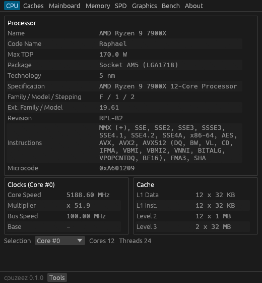 | 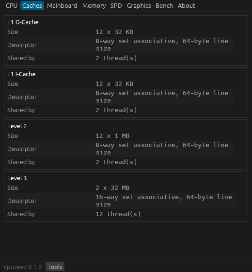 | 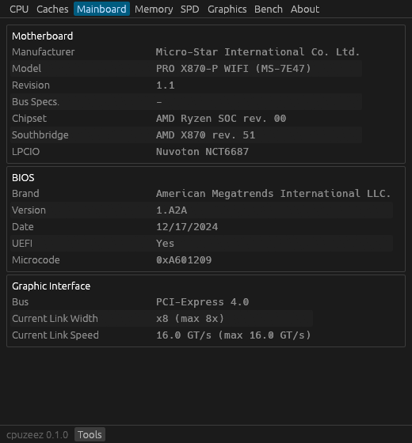 |
| **Memory** | **SPD** | **Graphics** |
| 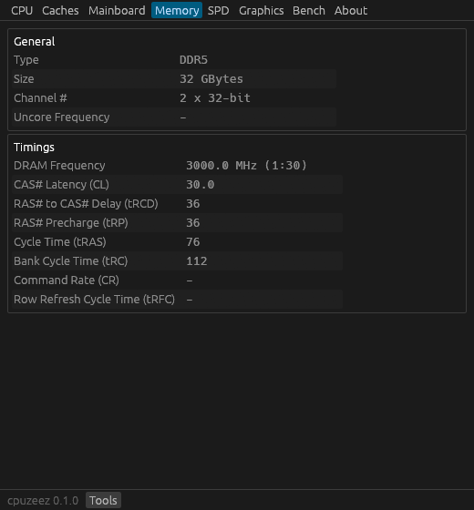 | 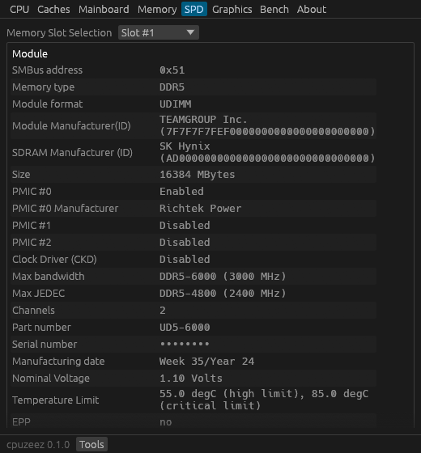 | 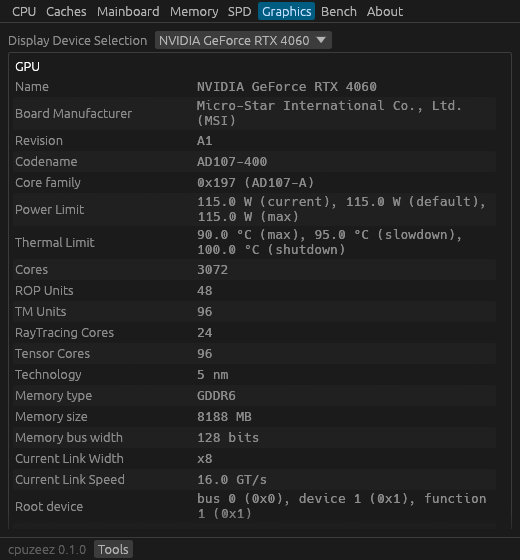 |
| **Bench** | **Tools ▸ Clocks** | **About** |
| 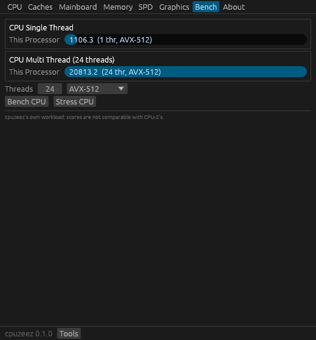 | 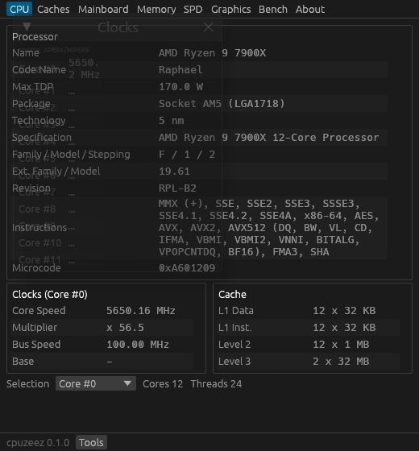 | 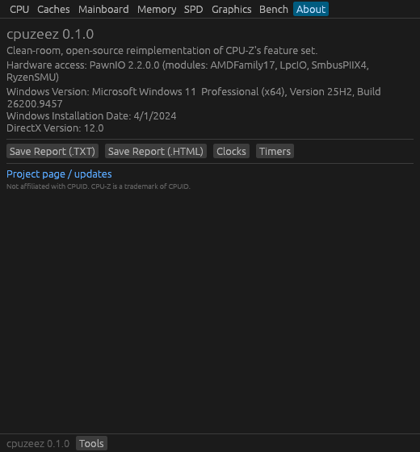 |

### Linux

Ubuntu 24.04 (WSLg, Wayland), same machine, NVIDIA through NVML:

| CPU | Graphics | Bench |
|---|---|---|
| 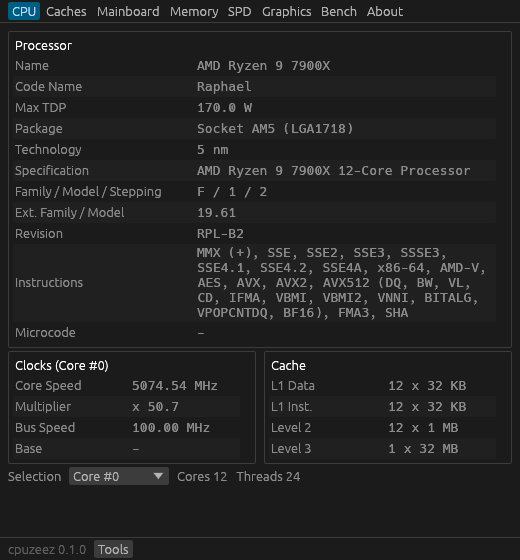 | 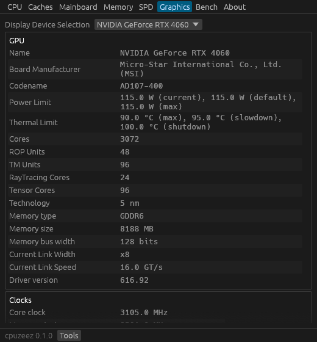 | 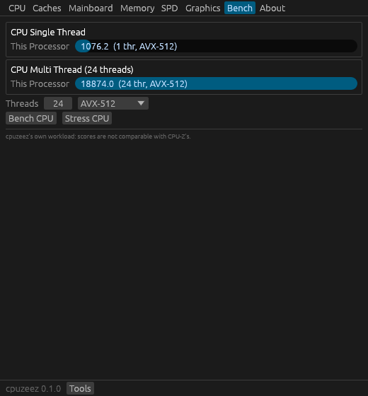 |

### macOS

The CI captures every tab on GitHub's macOS runners (Apple Silicon and Intel) on each push; see `docs/screenshots/macos/`.

## Install

Every [release](https://github.com/joaoregis/cpuzeez/releases) ships an installer per platform, plus `SHA256SUMS.txt`:

| Platform | File | Notes |
|---|---|---|
| Windows 10/11 x64 | `cpuzeez-<ver>-windows-x64.msi` | Per-machine install, Start-menu shortcut, adds `cpuzeez` to `PATH` |
| Windows (portable) | `cpuzeez-<ver>-windows-x64-portable.zip` | Just `cpuzeez.exe` |
| macOS 11+ (Intel and Apple Silicon) | `cpuzeez-<ver>-macos-universal.dmg` | Drag `cpuzeez.app` to Applications |
| macOS (installer) | `cpuzeez-<ver>-macos-universal.pkg` | Installs the app and `/usr/local/bin/cpuzeez` |
| Debian 12+, Ubuntu 22.04+ | `cpuzeez_<ver>_amd64.deb` / `_arm64.deb` | `sudo apt install ./cpuzeez_<ver>_amd64.deb` |
| Arch Linux | `cpuzeez-bin-<ver>-1-x86_64.pkg.tar.zst` | `sudo pacman -U cpuzeez-bin-*.pkg.tar.zst` |
| Any Linux (glibc 2.35+) | `cpuzeez-<ver>-linux-<arch>.tar.gz` | Binary, `.desktop` file and icon |

> **Unsigned binaries.** The installers are not code-signed, because that needs a paid certificate.
> - **Windows:** SmartScreen may say "Windows protected your PC". Click *More info → Run anyway*.
> - **macOS:** right-click the app → *Open* the first time, or run `xattr -dr com.apple.quarantine /Applications/cpuzeez.app`.

With Rust installed you can also run `cargo install --git https://github.com/joaoregis/cpuzeez`.

## Privileged hardware access

Like CPU-Z, some information can only come from hardware registers: MSRs, the SMBus where the SPD EEPROMs live, the Super I/O sensor chip, and memory-controller registers. CPU-Z installs its own kernel driver for this. **cpuzeez never ships a driver.** It uses what each OS already offers, and simply leaves out what it can't read.

| | Without privileges | With privileges |
|---|---|---|
| **Windows** | CPU, caches, topology, DMI, BIOS, PCI list and links, chipset names, memory type/size/channels, storage, USB, GPUs, monitors, OS, timers, bench | **+ PawnIO** (run as administrator): real core clocks (APERF/MPERF), P-states, preferred cores, SPD, AMD memory timings, Super I/O voltages/temps/fans, CPU temperatures and power, AMD SMU limits, DIMM temperatures |
| **Linux** | All of the above, plus hwmon sensors (`k10temp`, `coretemp`, `nct6775`, `it87`, …), cpufreq clocks, RAPL power, and SPD when `ee1004`/`spd5118` are bound | **+ root**: MSRs (`modprobe msr`), full PCI config space, SPD over `i2c-dev`, Super I/O via `/dev/port`, AMD SMN/UMC timings, SMU table via the optional `ryzen_smu` module |
| **macOS** | CPU (sysctl / CPUID), caches, clusters, SMBIOS (Intel) or IODeviceTree (Apple Silicon), PCI (IOKit), GPU and Metal, displays (EDID), storage, USB, SMC temperatures, fans and power, battery, bench | Nothing more: macOS doesn't allow third-party register access, and Apple Silicon has no SPD, MSRs or Super I/O |

### Windows: PawnIO

[PawnIO](https://pawnio.eu) is a signed, open-source, scriptable kernel driver, also used by LibreHardwareMonitor and FanControl.

1. Install it: `winget install namazso.PawnIO`, or get the installer from [pawnio.eu](https://pawnio.eu).
2. Download the official modules ([PawnIO.Modules releases](https://github.com/namazso/PawnIO.Modules/releases), LGPL-2.1). Extract the `.bin` files into a `pawnio-modules` folder next to `cpuzeez.exe`, or into the PawnIO install folder.
3. Run cpuzeez **as administrator**. *About* (and the report's *Binaries* section) then shows `Hardware access: PawnIO 2.2.0 (modules: …)`.

Details are in [docs/windows-pawnio.md](docs/windows-pawnio.md).

### Linux: kernel interfaces

```bash
sudo modprobe msr i2c-dev   # MSRs and SMBus
```
```bash
sudo modprobe spd5118       # DDR5 SPD (kernel 6.11+), or ee1004 for DDR4
```
```bash
sudo cpuzeez                # full detail; without sudo you still get most of it
```

## Usage

Run `cpuzeez` with no arguments to open the GUI. Every CPU-Z option works:

| Option | What it does |
|---|---|
| `-txt=FILE` | Full TXT report (CPU-Z's register-dump layout). `.txt` is added if missing |
| `-html=FILE` | HTML report (light/dark aware) |
| `-json=FILE` / `-jsontxt=FILE` | JSON report (the same tree as TXT) |
| `-console` | Print the TXT report to stdout |
| `-bench` | Single- and multi-threaded benchmark, saved as `<hostname>.txt` |
| `-core=N` | Print core #N's clock and exit |
| `-coremask=HEX` | Restrict `-bench` to these logical CPUs |
| `-screenshots=DIR` | Render every GUI tab to PNG and exit (docs/CI) |

GUI keys, as in CPU-Z:
- **F5** saves the current tab as `.bmp`.
- **F6** copies it to the clipboard.
- **F7** saves a `.cvf` file (our JSON report).

### `cpuzeez.ini`

Put it next to the executable. It accepts the same keys as `cpuz.ini`, and CPU-Z's UTF-16 file is read as is:

```ini
[CPU-Z]
PCI=1          ; 0 also disables chipset, SPD and SMBus
MaxPCIBus=256
DMI=1
Sensor=1
SMBus=1
SPD=1
LPCIO=1
Display=1
UseDisplayAPI=1 ; NVML / NVAPI / ADL
SMART=1
TextFontSize=0  ; 0 = default
```

Debugging a new mainboard: `CPUZEEZ_EC_DUMP=1 cpuzeez -txt=board` adds the Nuvoton EC register page to the report. That makes it easy to map fan and voltage inputs for boards we don't know yet.

## Feature coverage

The full spec, built from CPU-Z's own report and readme, is [FEATURES.md](FEATURES.md).

Legend:
- ✅ implemented and verified on the reference machine (Windows natively; Linux under WSL2, which only exposes what a VM can see)
- ☑️ implemented and compile/CI-tested on that OS, not yet checked on real hardware
- 🔑 needs admin/root (see above)
- ❌ not possible on that platform

| CPU-Z feature | Windows | Linux | macOS |
|---|---|---|---|
| Processor name, vendor, family/model/stepping, brand, instruction sets | ✅ | ✅ | ☑️ (ARM: sysctl / MIDR) |
| Codename, package, process, stepping name, TDP, Tjmax | ✅ | ✅ | ☑️ |
| Topology tree, CCD/CCX, hybrid P/E/LP cores, CPU groups (>64 threads) | ✅ | ✅ | ☑️ (perf levels) |
| Caches: size, ways, line, instances, sharing | ✅ | ✅ | ☑️ |
| Thread dumps: raw CPUID per thread | ✅ | ✅ | ☑️ (x86) |
| MSR dump, P-states (FID/VID), preferred cores (CPPC) | ✅🔑 | ☑️🔑 | ❌ |
| Core clock: APERF/MPERF, or OS, or measured | ✅🔑 / measured | ✅ measured / ☑️ cpufreq | ☑️ measured |
| AMD SMU: version, PPT/TDC/EDC | ✅🔑 | ☑️🔑 (`ryzen_smu`) | ❌ |
| CPU temperatures, VID, package/core power (RAPL), per-core clocks | ✅🔑 | ☑️ hwmon / 🔑 | ☑️ SMC |
| Timers: ACPI, perf, system | ✅ | ✅ | ☑️ |
| BIOS: UEFI, date, AGESA / microcode | ✅ | ✅ | ☑️ (iBoot) |
| DMI / SMBIOS: every type CPU-Z shows | ✅ | ☑️🔑 (partial without root) | ☑️ Intel / synthesized on ARM |
| Chipset: northbridge/southbridge + revision, graphic interface link | ✅ | ☑️ | ☑️ |
| Memory type, size, channels | ✅ | ✅ | ☑️ |
| Memory frequency, CL/tRCD/tRP/tRAS/tRC, ratio | ✅🔑 AMD (Intel: planned²) | ☑️🔑 AMD (Intel: planned²) | ❌ |
| SPD: all fields, JEDEC/XMP/EXPO tables, hex dump | ✅🔑 | ☑️ (`spd5118`/`ee1004`) / 🔑 | ❌ (soldered memory) |
| DIMM temperatures | ✅🔑 | ☑️ | ❌ |
| LPCIO: Super I/O vendor, model, IDs, config registers | ✅🔑 | ☑️🔑 | ❌ |
| Hardware monitors: voltages, temperatures, fans (Super I/O) | ✅🔑 (Nuvoton EC verified) | ☑️ hwmon | ☑️ SMC |
| PCI device list, IDs, names, links | ✅ | ✅ | ☑️ |
| PCI capabilities decode and config hex dump | ❌¹ | ✅ (full with root) | ❌ |
| Storage: model, serial, firmware, capacity, bus, link, RPM, SMART, volumes | ✅ | ✅ | ☑️ |
| USB devices | ✅ | ☑️ | ☑️ |
| Graphics: GPU specs, clocks, power/thermal limits, VRAM, link, driver | ✅ (NVML, NVAPI, ADL, DXGI) | ✅ (DRM, NVML) | ☑️ (Metal) |
| Monitors (EDID) | ✅ | ✅ | ☑️ |
| NPU / AI devices | ✅ | ☑️ (`/sys/class/accel`) | ☑️ (ANE) |
| Software: OS, edition, build, install date, DirectX / Vulkan / Metal | ✅ | ✅ | ☑️ |
| Register spaces | ✅ | ☑️ | ❌ |
| TXT / HTML / JSON reports, console, `-core`, `-coremask` | ✅ | ✅ | ☑️ |
| Bench (ST/MT, threads, SIMD variant, core set), Stress CPU | ✅ | ✅ | ☑️ |
| Clocks and Timers windows, F5/F6/F7, minimized clock title | ✅ | ✅ | ☑️ |

¹ No PawnIO module offers generic PCI configuration access on Windows. Device IDs, names and links still come from the OS.
² MCHBAR register access is already implemented (PawnIO `IntelMCHBAR`, Linux `/dev/mem`). What's missing is the per-generation timing-register decode.

### Deliberately not included

- **Online validation** (valid.x86.fr, Validator Statistics). It is CPUID's service, so cpuzeez doesn't submit to it. Share the HTML/JSON report instead.
- **CPU-Z's benchmark algorithm and reference scores.** They are CPUID's work. cpuzeez's benchmark is its own, and its scores are not comparable with CPU-Z's.
- **Obsolete targets:** Itanium/IA-64, Windows 9x, and CPUs older than i686. None of today's target OSes run on them.

## Accuracy: side by side with CPU-Z

On the reference machine (Ryzen 9 7900X, MSI PRO X870-P WIFI, Windows 11 25H2), `cpuzeez -txt` was compared section by section with `cpuz.exe -txt`:

- **Same output as CPU-Z:**
  - **CPU and topology:**
    - APIC topology tree (2 CCDs, APIC IDs 0–27), instruction sets (`MMX (+), SSE … AVX512 (DQ, BW, VL, CD, IFMA, VBMI, VBMI2, VNNI, BITALG, VPOPCNTDQ, BF16), FMA3, SHA`).
    - Caches (`12 x 32 KB`, `12 x 1024 KB`, `2 x 32 MB`), microcode `0xA601209`, codename/package/stepping/TDP (`Raphael`, `Socket AM5 (LGA1718)`, `RPL-B2`, `170 W`).
    - P-states (`FID 0x8BC - VID 0xC9 (47.00x - 1.256 V)`), preferred cores (`2 (#0, #1)`), SMU version (`84.79.225`), PPT/TDC/EDC.
  - **Firmware and memory:**
    - BIOS/AGESA (`ComboAm5PI 1.2.0.2b`).
    - Memory timings (DDR5, `30-36-36-76`, tRC 112, 1:30).
    - **SPD:** the 2 × 1024 raw bytes read live are byte-identical to CPU-Z's, and so is every decoded field and the JEDEC/XMP 3.0/EXPO tables.
  - **Sensors and buses:**
    - LPCIO registers, NCT6687 voltages and fans.
    - DMI tables, storage, USB, GPUs (RTX 4060 `AD107-400`, 3072 cores, limits, clocks), monitor EDID, OS line.
  - **Timers:** `3.580 MHz`, `10.000 MHz`, `1.000 KHz`.
- **Intentional differences:**
  - **BIOS ROM size:** we print `32768 KB`. The SMBIOS extended ROM-size field says 32 MB; CPU-Z ignores it and shows `16384 KB`.
  - **RTX 4060 TMUs:** we print `96`, the public spec (24 SMs × 4); CPU-Z prints 192.
  - **Memory frequency:** we print `3000.0 MHz`. We use the nominal 100 MHz reference clock, while CPU-Z measures it (`2998.8 MHz` at 99.96 MHz).
- **Not yet decoded:** Zen 4 SMU per-core/L3/SoC temperatures and VDDCR rails, per-core max ratio, Uncore frequency, PCIe "Bus Specification" on Windows, and Intel memory timings.

## Clean-room process

cpuzeez was built so that no expression of CPU-Z (its code, tables or text) could end up in this project:

1. **Black-box observation.** CPU-Z's documented `-txt` option produced its own report of a test machine. That report shows what CPU-Z reports and in which format, not how it does it.
2. **Feature inventory.** The readme and the exported string and RTTI class names of `cpuz.exe`, inspected with [REA](https://github.com/morluto/rea) and Ghidra, list which features and hardware families exist (e.g. "Nuvoton NCT6687 hardware monitor", "XMP profile"). **No function was decompiled or translated.**
3. **Spec.** Both were condensed into [FEATURES.md](FEATURES.md): what is shown, per OS, with feasibility.
4. **Implementation from public sources only:**
   - CPU and firmware: Intel SDM, AMD APM/PPR, DMTF SMBIOS.
   - Memory: JEDEC SPD annexes, JEP106, Intel XMP and AMD EXPO layouts.
   - Buses and displays: PCI/PCIe specs, VESA EDID.
   - Chips and GPUs: chip datasheets, NVML/ADL/DXGI/IOKit docs, Linux sysfs ABIs.
   - CPU/GPU spec tables: vendors' public pages.
   - The implementers worked from the spec, not from the binary.
5. **Verification against behaviour.** The output was compared with CPU-Z's report on the same hardware (see above). Where they differ, we follow the public spec.

## Building from source

Requires Rust 1.89+ (`rustup`). There are no system libraries to install, on Linux included: the GUI loads X11/Wayland/OpenGL at runtime.

```bash
git clone https://github.com/joaoregis/cpuzeez
```
```bash
cargo build --release
```
```bash
cargo test
```
```bash
cargo build --release --no-default-features
```

The last command builds the CLI only, without the GUI.

CI ([`.github/workflows/ci.yml`](.github/workflows/ci.yml)):
- **Native runners:** Windows, Ubuntu x64/arm64 and macOS arm64/x64. Each job runs rustfmt, clippy and the tests, then the binary itself (every report format, `-core`, `-bench`, GUI screenshots).
- **Containers:** Debian, Ubuntu 22.04 and Arch Linux.

Release ([`.github/workflows/release.yml`](.github/workflows/release.yml)): pushing a `v*` tag builds the MSI (WiX), the DMG/PKG (universal binary), the `.deb` (cargo-deb) and the Arch package (makepkg), and attaches them to a GitHub release.

## Architecture

```
src/
├── main.rs        CLI (CPU-Z options), Ctx (config + hardware backend + caches), section order
├── report.rs      report tree (Field / Group / Hex) → TXT, HTML, JSON
├── config.rs      cpuzeez.ini (same keys as cpuz.ini)
├── hw/            privileged access: trait Hw { rdmsr, pci_read, io, smn, smbus, smu, mchbar }
│   ├── windows.rs   PawnIO backend
│   └── linux.rs     /dev/cpu/*/msr, sysfs PCI, /dev/port, i2c-dev, ryzen_smu, /dev/mem
├── cpu/           CPUID (x86.rs), ARM (arm.rs), clocks, names database (db.rs)
├── smbios.rs      SMBIOS parser + DMI section          bios.rs     BIOS section
├── pci/           enumeration per OS + capability decoder     chipset.rs  NB/SB, memory timings
├── spd/           SPD decoders, JEP106, SMBus/SPD5118 reading
├── sensors/       Super I/O, CPU (SMN/RAPL/SMU), hwmon, SMC, PDH
├── gpu/           DXGI/NVML/NVAPI/ADL/DRM/Metal, GPU spec table, EDID      npu.rs
├── storage.rs  usb.rs  software.rs  timers.rs  bench.rs
└── gui/           egui front-end (tabs, Clocks/Timers, F5/F6/F7, -screenshots)
```

Every probe returns report sections. The GUI, the TXT/HTML/JSON writers and `-console` all read that same tree, so the GUI and the report always agree.

## Contributing

Issues and PRs are welcome, especially:
- **New mainboards:** attach `CPUZEEZ_EC_DUMP=1 cpuzeez -txt=board` output, plus your board's sensor labels.
- **CPUs and GPUs missing from the tables** (`src/cpu/db.rs`, `src/gpu/db.rs`): cite a public source.
- **Reports from macOS and from Intel systems.**

Please keep the clean-room rule: **don't contribute anything derived from CPU-Z's binary**. Work from public documentation.

## License

Licensed under either of [Apache License 2.0](LICENSE-APACHE) or [MIT license](LICENSE-MIT), at your option.

PawnIO and its modules are separate projects under their own licenses. They are not bundled.
