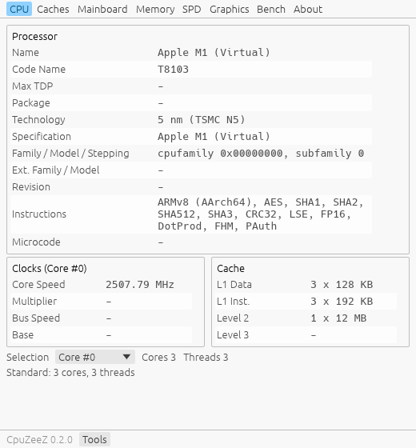
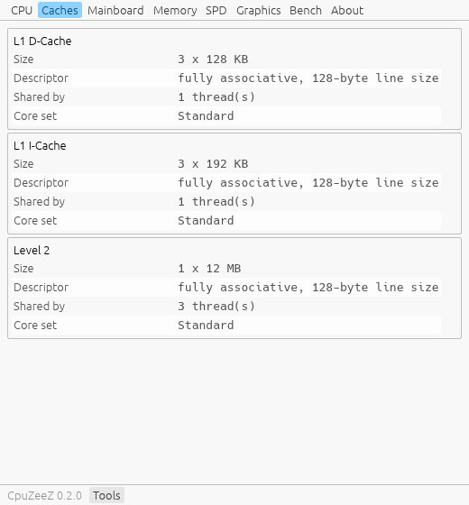
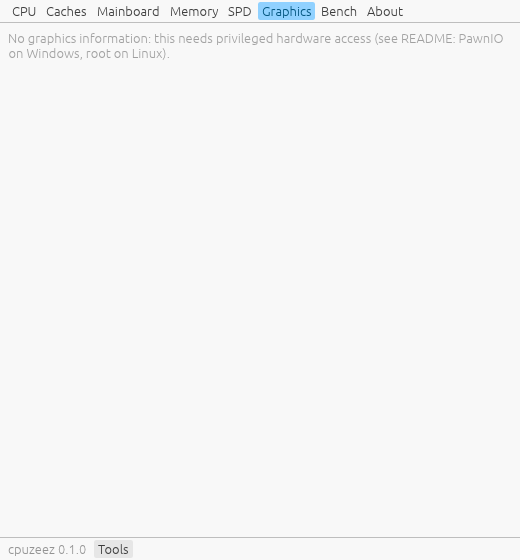
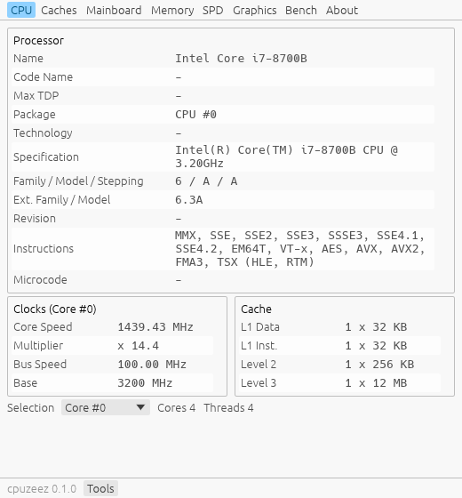
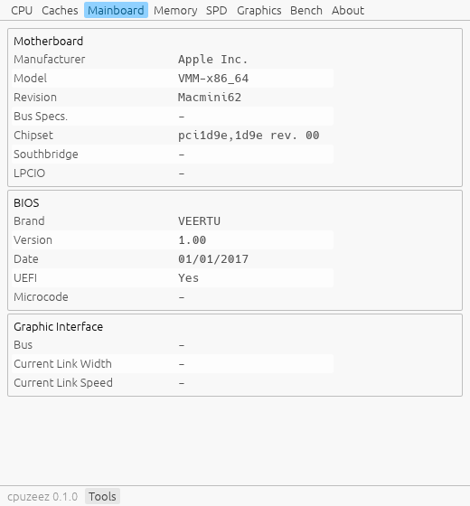
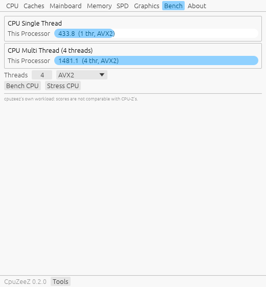

<div align="center">


**Reimplementação clean room, open source e multiplataforma das funcionalidades do CPU-Z, escrita em Rust.**

Processador, caches, placa-mãe, memória, SPD, gráficos, sensores, armazenamento, benchmark e relatórios TXT/HTML/JSON completos, no **Windows, Linux (Debian, Ubuntu, Arch, …) e macOS (Intel e Apple Silicon)**.

[English](README.md) · [Download](#instalação) · [Atualizações](#atualizações) · [Screenshots](#screenshots) · [Cobertura](#cobertura-de-funcionalidades) · [Processo clean room](#processo-clean-room)

</div>

---

> O CpuZeeZ (`cpuzeez`) **não tem vínculo com a CPUID**. CPU-Z é marca registrada da CPUID. Nenhum código, tabela ou texto do CPU-Z foi usado. Veja [Processo clean room](#processo-clean-room).

## Destaques

- **As abas que quem usa o CPU-Z conhece:** CPU, Caches, Mainboard, Memory, SPD, Graphics, Bench e About, mais as janelas Tools ▸ Clocks e Tools ▸ Timers.
- **O layout de relatório do CPU-Z.** O `-txt` gera as mesmas 23 seções, na mesma ordem do dump do CPU-Z, de *Binaries* a *Register Spaces*. O `-html` e o `-json` geram os mesmos dados.
- **A linha de comando do CPU-Z:**
  - `-txt=`, `-html=`, `-json=`, `-jsontxt=`
  - `-console`, `-bench`, `-core=`, `-coremask=`
  - um `cpuzeez.ini` com as mesmas chaves do `cpuz.ini`
- **CPU:**
  - decodificação completa de CPUID, com a lista de instruções na notação do CPU-Z
  - topologia por thread (socket → nó → CCD → CCX → núcleo → thread), incluindo núcleos híbridos P/E/LP
  - instâncias de cache
  - codinome, pacote, processo, stepping, TDP e Tjmax para CPUs x86 de 2008 a 2026, e Apple M1–M5
- **SPD:** decodificadores para SDR, DDR, DDR2/FB-DIMM, DDR3, DDR4, DDR5 (UDIMM, RDIMM, SODIMM, CUDIMM, CAMM2…) e LPDDR4/5, com XMP 1.x/2.0/3.0, EXPO, EPP e nomes de fabricante JEP106.
- **Sensores:** chips Super I/O (Nuvoton, ITE, Fintek, Winbond), SMU da AMD (PPT/TDC/EDC), potência RAPL, sensor térmico das DIMMs, hwmon no Linux, SMC da Apple e sensores de GPU (NVML, ADL).
- **Benchmark:** execuções com uma e com várias threads, variantes Scalar, AVX2, AVX-512 e NEON, e Stress CPU.
- **Um único binário nativo**, de cerca de 8 MB, sem dependências em tempo de execução. A interface é desenhada com egui (OpenGL).

## Screenshots

Geradas com `cpuzeez -screenshots=DIR`, que renderiza cada aba e salva um PNG. No Windows, vêm de um AMD Ryzen 9 7900X, MSI PRO X870-P WIFI, 2×16 GB DDR5-6000 e uma RTX 4060, rodando como administrador com o PawnIO.

### Windows 11

| CPU | Caches | Mainboard |
|---|---|---|
|  |  |  |
| **Memory** | **SPD** | **Graphics** |
|  |  |  |
| **Bench** | **Tools ▸ Clocks** | **About** |
|  |  |  |

### Linux

Ubuntu 24.04 (WSLg, Wayland), na mesma máquina, NVIDIA via NVML:

| CPU | Graphics | Bench |
|---|---|---|
|  |  |  |

### macOS

Geradas pelo CI nos runners macOS do GitHub (máquinas virtuais, então alguns campos mostram o que o hypervisor expõe):

| Apple Silicon: CPU | Apple Silicon: Caches | Apple Silicon: Graphics |
|---|---|---|
|  |  |  |
| **Mac Intel: CPU** | **Mac Intel: Mainboard** | **Mac Intel: Bench** |
|  |  |  |

## Instalação

Cada [release](https://github.com/joaoregis/cpuzeez/releases) traz um instalador por plataforma, mais o `SHA256SUMS.txt`:

| Plataforma | Arquivo | Observações |
|---|---|---|
| Windows 10/11 x64 | `cpuzeez-<ver>-windows-x64.msi` | Instala para todos os usuários, cria atalho no menu Iniciar e adiciona o `cpuzeez` ao `PATH` |
| Windows (portátil) | `cpuzeez-<ver>-windows-x64-portable.zip` | Só o `cpuzeez.exe` |
| macOS 11+ (Intel e Apple Silicon) | `cpuzeez-<ver>-macos-universal.dmg` | Arraste o `CpuZeeZ.app` para Aplicativos |
| macOS (instalador) | `cpuzeez-<ver>-macos-universal.pkg` | Instala o app e o `/usr/local/bin/cpuzeez` |
| Debian 12+, Ubuntu 22.04+ | `cpuzeez_<ver>_amd64.deb` / `_arm64.deb` | `sudo apt install ./cpuzeez_<ver>_amd64.deb` |
| Arch Linux | `cpuzeez-bin-<ver>-1-x86_64.pkg.tar.zst` | `sudo pacman -U cpuzeez-bin-*.pkg.tar.zst` |
| Qualquer Linux (glibc 2.35+) | `cpuzeez-<ver>-linux-<arch>.tar.gz` | Binário, arquivo `.desktop` e ícone |

> **Sem certificado do publicador.** Os instaladores não têm assinatura com certificado do publicador, porque isso exige certificado pago. Os executáveis macOS usam assinatura ad-hoc, que não identifica o desenvolvedor nem fornece notarização da Apple.
> - **Windows:** o SmartScreen pode mostrar "O Windows protegeu o computador". Clique em *Mais informações → Executar assim mesmo*.
> - **macOS:** o Gatekeeper pode bloquear o app ou o `.pkg` porque a Apple não consegue verificar o desenvolvedor. Confira o download com `SHA256SUMS.txt`, tente abrir uma vez e feche o aviso. Vá a *Ajustes do Sistema → Privacidade e Segurança → Abrir Mesmo Assim* e confirme *Abrir*. Para o `.pkg`, conclua a instalação e repita para o app se aparecer outro aviso. No macOS 11–12, a opção fica em *Preferências do Sistema → Segurança e Privacidade → Geral*. Clicar com o botão direito → *Abrir* não contorna mais essa verificação no macOS 15 ou posterior. Veja as [instruções da Apple](https://support.apple.com/pt-br/102445). A assinatura ad-hoc sozinha não elimina o aviso; para isso, as releases precisam de assinatura Developer ID e notarização da Apple.

Com Rust instalado, também dá para usar `cargo install --git https://github.com/joaoregis/cpuzeez`.

## Acesso privilegiado ao hardware

Como no CPU-Z, algumas informações só vêm de registradores do hardware: MSRs, o SMBus onde ficam as EEPROMs SPD, o chip Super I/O dos sensores e os registradores do controlador de memória. O CPU-Z instala o próprio driver de kernel para isso. **O CpuZeeZ nunca traz driver.** Ele usa o que cada sistema já oferece e simplesmente omite o que não consegue ler.

| | Sem privilégios | Com privilégios |
|---|---|---|
| **Windows** | CPU, caches, topologia, DMI, BIOS, lista e links PCI, nomes do chipset, tipo/tamanho/canais da memória, discos, USB, GPUs, monitores, SO, timers, benchmark | **+ PawnIO** (como administrador): clock real dos núcleos (APERF/MPERF), P-states, núcleos preferenciais, SPD, timings de memória AMD, voltagens/temperaturas/ventoinhas do Super I/O, temperaturas e potência da CPU, limites do SMU da AMD, temperatura das DIMMs |
| **Linux** | Tudo acima, mais sensores hwmon (`k10temp`, `coretemp`, `nct6775`, `it87`, …), clocks via cpufreq, potência RAPL, e SPD quando `ee1004`/`spd5118` estão carregados | **+ root**: MSRs (`modprobe msr`), PCI config completo, SPD via `i2c-dev`, Super I/O via `/dev/port`, timings AMD via SMN/UMC, tabela do SMU com o módulo opcional `ryzen_smu` |
| **macOS** | CPU (sysctl / CPUID), caches, clusters, SMBIOS (Intel) ou IODeviceTree (Apple Silicon), PCI (IOKit), GPU e Metal, monitores (EDID), discos, USB, temperaturas, ventoinhas e potência do SMC, bateria, benchmark | Nada a mais: o macOS não permite acesso de terceiros a registradores, e o Apple Silicon não tem SPD, MSRs nem Super I/O |

### Windows: PawnIO

O [PawnIO](https://pawnio.eu) é um driver de kernel assinado, open source e programável, também usado pelo LibreHardwareMonitor e pelo FanControl.

1. Instale: `winget install namazso.PawnIO`, ou baixe o instalador em [pawnio.eu](https://pawnio.eu).
2. Baixe os módulos oficiais ([releases do PawnIO.Modules](https://github.com/namazso/PawnIO.Modules/releases), LGPL-2.1). Extraia os `.bin` numa pasta `pawnio-modules` ao lado do `cpuzeez.exe`, ou na pasta de instalação do PawnIO.
3. Rode o CpuZeeZ **como administrador**. A aba *About* (e a seção *Binaries* do relatório) passa a mostrar `Hardware access: PawnIO 2.2.0 (modules: …)`.

Detalhes em [docs/windows-pawnio.md](docs/windows-pawnio.md).

### Linux: interfaces do kernel

```bash
sudo modprobe msr i2c-dev   # MSRs e SMBus
```
```bash
sudo modprobe spd5118       # SPD DDR5 (kernel 6.11+), ou ee1004 para DDR4
```
```bash
sudo cpuzeez                # detalhe completo; sem sudo você ainda vê quase tudo
```

## Uso

Rode `cpuzeez` sem argumentos para abrir a interface. Todas as opções do CPU-Z funcionam:

| Opção | O que faz |
|---|---|
| `-txt=ARQ` | Relatório TXT completo (layout do dump do CPU-Z). O `.txt` é adicionado se faltar |
| `-html=ARQ` | Relatório HTML (com tema claro e escuro) |
| `-json=ARQ` / `-jsontxt=ARQ` | Relatório JSON (a mesma árvore do TXT) |
| `-console` | Imprime o relatório TXT no terminal |
| `-bench` | Benchmark com uma e com várias threads, salvo em `<hostname>.txt` |
| `-core=N` | Mostra o clock do núcleo N e sai |
| `-coremask=HEX` | Restringe o `-bench` a essas CPUs lógicas |
| `-checkupdate` | Verifica se há release mais nova no GitHub |
| `-screenshots=DIR` | Renderiza cada aba em PNG e sai (para docs e CI) |

Atalhos da interface, como no CPU-Z:
- **F5** salva a aba atual em `.bmp`.
- **F6** copia a aba para a área de transferência.
- **F7** salva um arquivo `.cvf` (o nosso relatório JSON).

O `cpuzeez.ini` fica ao lado do executável e aceita as mesmas chaves do `cpuz.ini`. O arquivo UTF-16 do próprio CPU-Z é lido sem conversão. Para mapear uma placa-mãe nova, `CPUZEEZ_EC_DUMP=1 cpuzeez -txt=placa` inclui no relatório a página de registradores do EC Nuvoton.

## Atualizações

**Aviso de atualização.** Ao abrir, o CpuZeeZ pergunta à API de releases do GitHub se existe versão mais nova. É um único `GET` anônimo; nada sobre o seu computador é enviado.
- Se houver, uma faixa no topo da janela oferece **Download**, que baixa o instalador do seu SO e da sua CPU, e **What's new**.
- Também dá para checar na hora, em *About ▸ Check for updates*, ou no terminal com `cpuzeez -checkupdate`.
- Para desligar, use `CheckUpdates=0` no `cpuzeez.ini`.
- O aviso usa o `curl` do sistema, que já vem no Windows 10+, no macOS e nas distros Linux desktop.

**Para atualizar**, basta instalar a versão nova por cima:

| Plataforma | Como |
|---|---|
| Windows | Rode o `.msi` novo. Ele atualiza no lugar: mesma pasta, um único item em *Aplicativos instalados*, PATH e atalho mantidos. Instalar uma versão mais antiga por cima de uma mais nova é recusado. O CI instala um MSI, atualiza por cima e confere o bloqueio de downgrade a cada push. |
| macOS | Arraste o `CpuZeeZ.app` novo por cima do antigo, ou rode o `.pkg` novo |
| Debian / Ubuntu | `sudo apt install ./cpuzeez_<ver>_amd64.deb` |
| Arch | `sudo pacman -U cpuzeez-bin-<ver>-1-x86_64.pkg.tar.zst` |

## Cobertura de funcionalidades

A especificação completa, montada a partir do relatório e do readme do próprio CPU-Z, está em [FEATURES.md](FEATURES.md). A tabela detalhada por SO está no [README em inglês](README.md#feature-coverage). Resumo:

- **Tudo o que se aplica a cada plataforma foi implementado:**
  - CPU, topologia, caches, dumps de CPUID e MSR, P-states, clocks
  - SMBIOS/DMI, BIOS, chipset, timings de memória AMD
  - SPD de todas as gerações, LPCIO, sensores
  - PCI, discos, USB, GPUs, monitores, NPUs, software, timers
  - relatórios, benchmark, interface
- **Impossível por limitação da plataforma:**
  - **macOS:** sem SPD (memória soldada), sem timings de memória, sem Super I/O e sem PCI config. Sem MSRs no Apple Silicon.
  - **Windows:** sem decodificação de capabilities PCI, porque nenhum módulo do PawnIO dá acesso genérico ao PCI config.
- **Ainda não decodificado:**
  - timings de memória Intel (o acesso ao MCHBAR já existe)
  - temperaturas por núcleo, L3 e SoC, e trilhos VDDCR do SMU Zen 4
  - Uncore e o "Bus Specification" PCIe no Windows
- **Fora de escopo de propósito:**
  - validação online (valid.x86.fr, serviço da CPUID)
  - o algoritmo e os scores de referência do benchmark do CPU-Z (o nosso é próprio, e os scores não são comparáveis)
  - alvos obsoletos: IA-64, Win9x, CPUs anteriores ao i686

## Precisão: lado a lado com o CPU-Z

Na máquina de referência (Ryzen 9 7900X, MSI PRO X870-P WIFI, Windows 11 25H2), o `cpuzeez -txt` foi comparado seção por seção com o `cpuz.exe -txt`. Saíram iguais:

- **CPU:**
  - árvore de topologia, lista de instruções, caches, microcode
  - codinome, pacote, stepping, TDP
  - P-states (`47.00x - 1.256 V`), núcleos preferenciais, versão do SMU (`84.79.225`), PPT/TDC/EDC
- **BIOS:** AGESA.
- **Memória:** timings (DDR5 `30-36-36-76`, 1:30).
- **SPD:** os 2 × 1024 bytes lidos ao vivo são **idênticos byte a byte aos lidos pelo CPU-Z**, assim como os campos decodificados e as tabelas JEDEC, XMP 3.0 e EXPO.
- **Sensores:** registradores do LPCIO, voltagens e ventoinhas do NCT6687.
- **DMI, discos, USB, GPUs e monitor:** RTX 4060 `AD107-400`, 3072 cores, limites e clocks, e o EDID do monitor.
- **Timers.**

Diferenças intencionais:
- **Tamanho da ROM do BIOS:** mostramos 32 MB, o campo estendido da especificação SMBIOS. O CPU-Z ignora esse campo e mostra 16 MB.
- **TMUs da RTX 4060:** mostramos 96, a especificação pública (24 SMs × 4). O CPU-Z mostra 192.
- **Clock de referência:** usamos o nominal de 100 MHz, onde o CPU-Z mede o valor real (99,96 MHz).

## Processo clean room

1. **Observação de caixa-preta.** A opção documentada `-txt` do CPU-Z gerou o relatório dele numa máquina de teste. Isso mostra *o que* o CPU-Z exibe e em que formato, não *como* ele faz.
2. **Inventário de funcionalidades.** O readme e os nomes de strings e classes RTTI exportados pelo `cpuz.exe`, inspecionados com o [REA](https://github.com/morluto/rea) e o Ghidra, mostram *quais* funcionalidades e famílias de hardware existem. **Nenhuma função foi descompilada ou traduzida.**
3. **Especificação.** Tudo isso virou o [FEATURES.md](FEATURES.md).
4. **Implementação só com fontes públicas:**
   - CPU e firmware: Intel SDM, AMD APM/PPR, DMTF SMBIOS.
   - Memória: anexos SPD da JEDEC, JEP106, XMP e EXPO.
   - Barramentos e telas: especificações PCI/PCIe, VESA EDID.
   - Chips e GPUs: datasheets dos chips e documentação de NVML, ADL, DXGI, IOKit e sysfs.
5. **Verificação por comportamento.** A saída foi comparada com o relatório do CPU-Z no mesmo hardware. Onde há diferença, seguimos a especificação pública.

## Compilando

Requer Rust 1.89+. Não há bibliotecas de sistema para instalar, nem no Linux: a interface carrega X11/Wayland/OpenGL em tempo de execução.

```bash
git clone https://github.com/joaoregis/cpuzeez
```
```bash
cargo build --release
```
```bash
cargo test
```

O CI ([`ci.yml`](.github/workflows/ci.yml)) compila, testa e roda o binário de verdade em:
- runners nativos de Windows, Ubuntu x64/arm64 e macOS arm64/x64
- containers Debian, Ubuntu 22.04 e Arch

O workflow de release ([`release.yml`](.github/workflows/release.yml)) gera o MSI, o DMG/PKG, o `.deb` e o pacote do Arch a cada tag `v*`.

## Contribuindo

Issues e PRs são bem-vindos, principalmente:
- **placas-mãe novas:** envie a saída de `CPUZEEZ_EC_DUMP=1 cpuzeez -txt=placa` com os nomes dos sensores da sua placa
- **CPUs e GPUs que faltam nas tabelas**, citando fonte pública
- **relatórios de macOS e de sistemas Intel**

Mantenha a regra clean room: **nada derivado do binário do CPU-Z**.

## Licença

Licenciado sob [Apache 2.0](LICENSE-APACHE) ou [MIT](LICENSE-MIT), à sua escolha. O PawnIO e seus módulos são projetos separados, com licenças próprias, e não acompanham o CpuZeeZ.
